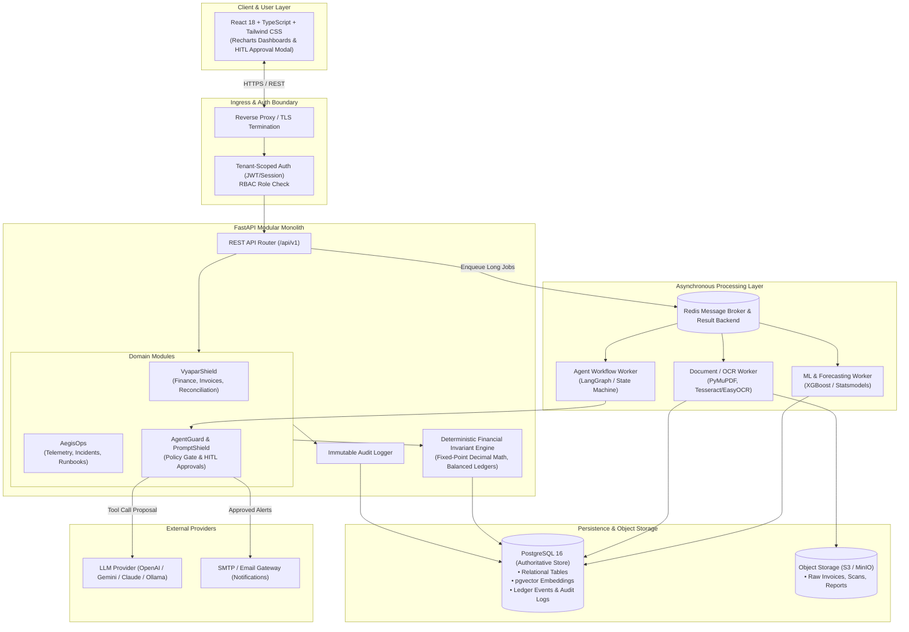
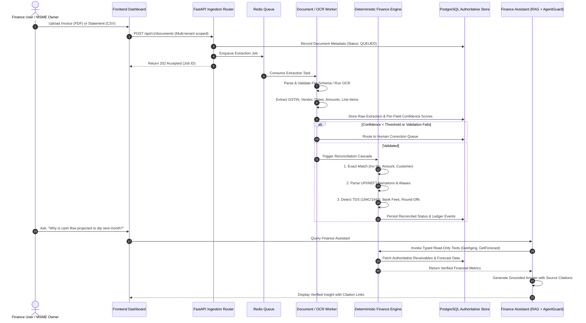
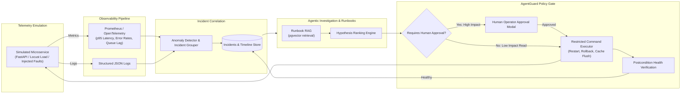
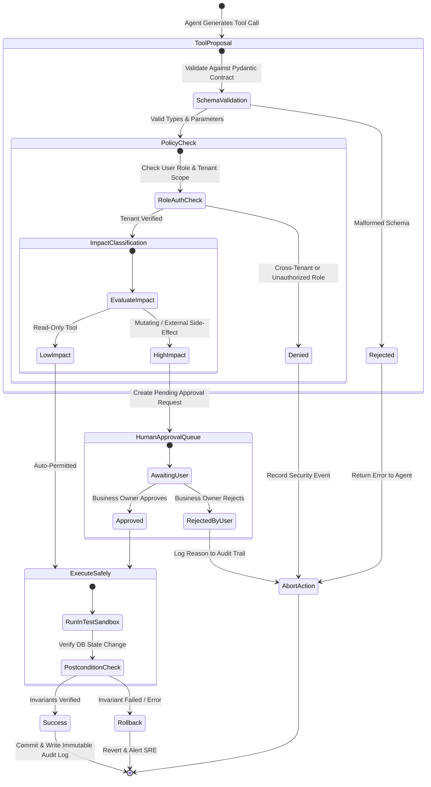

# NexusOps AI — End-to-End System Architecture

**Document Version:** 1.0.0  
**Phase:** A0.1 — System Design & Visual Architecture  
**Status:** Approved Specification  

---

## 1. High-Level System Architecture

NexusOps AI is architected as a **Modular Monolith with Asynchronous Task Workers**. It delivers real-time HTTP operations via FastAPI, heavy document extraction and ML inference via asynchronous Redis/Celery workers, and stores authoritative financial state and vector embeddings in PostgreSQL 16.

---

## 2. VyaparShield: End-to-End Invoice-to-Cash Pipeline

The financial pipeline converts untrusted source files (invoices, bank statements, transaction logs) into verified, reconciled accounts receivable records and grounded business insights:

---

## 3. AegisOps: Incident-to-Resolution Pipeline

AegisOps monitors telemetry emitted by a simulated test service, detects operational anomalies, retrieves runbooks, and coordinates policy-checked remediation:

---

## 4. AgentGuard: Multi-Stage Execution Gate

Every autonomous action proposed by an agent (e.g., dispatching overdue reminder notices or applying ledger adjustments) must pass through independent server-side enforcement:

---

## 5. Network, Storage and Boundary Summary

| Boundary | Ingress Protocol | Protection Mechanism | Failure Behavior |
| :--- | :--- | :--- | :--- |
| **Client → API** | HTTPS / TLS 1.3 | JWT Auth, CORS, Rate Limiting (Redis token bucket) | HTTP 401 Unauthorized / 429 Too Many Requests |
| **API → PostgreSQL** | PostgreSQL Wire (SSL) | Connection Pool (SQLAlchemy async), Tenant RLS | Connection retry with exponential backoff |
| **API → Redis** | RESP over TCP (Auth) | Bounded queue depths, dead-letter exchange (DLQ) | Graceful degradation to sync fallback or queue alert |
| **Backend → LLM API** | HTTPS | Token budget limiter, prompt injection scrubber, secret masking | Fallback to cached template or missing-data notice |
