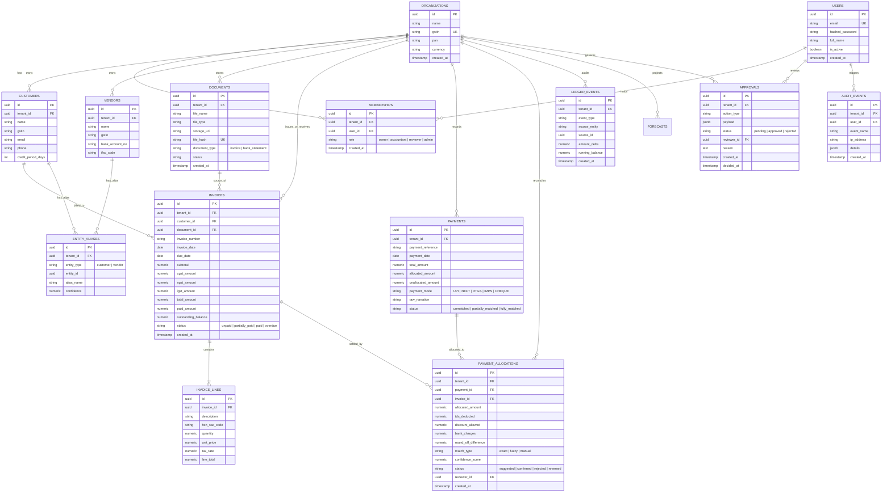

# VyaparShield — Database Entity-Relationship (ER) Diagram

**Phase:** Phase 0 — Engineering Design & Database Architecture  
**Database:** PostgreSQL 16 with `pgvector`  

---

## 1. Visual Entity-Relationship Diagram

---

## 2. Integrity and Relational Constraints

1. **Foreign Key Cascade Policy:**
   - Invoices reference `customers(id)` with `ON DELETE RESTRICT` (customers with active invoices cannot be deleted).
   - `invoice_lines` reference `invoices(id)` with `ON DELETE CASCADE`.
   - `payment_allocations` reference `payments(id)` and `invoices(id)` with `ON DELETE RESTRICT`.
2. **Unique Business Keys:**
   - Composite Unique: `(tenant_id, invoice_number)` ensures no duplicate invoice numbers within the same business tenant.
   - Unique: `(file_hash)` prevents uploading the exact same document twice.
3. **Check Constraints:**
   - `invoices.outstanding_balance >= 0`
   - `invoices.paid_amount >= 0`
   - `payments.allocated_amount <= payments.total_amount`
   - `payments.unallocated_amount >= 0`
